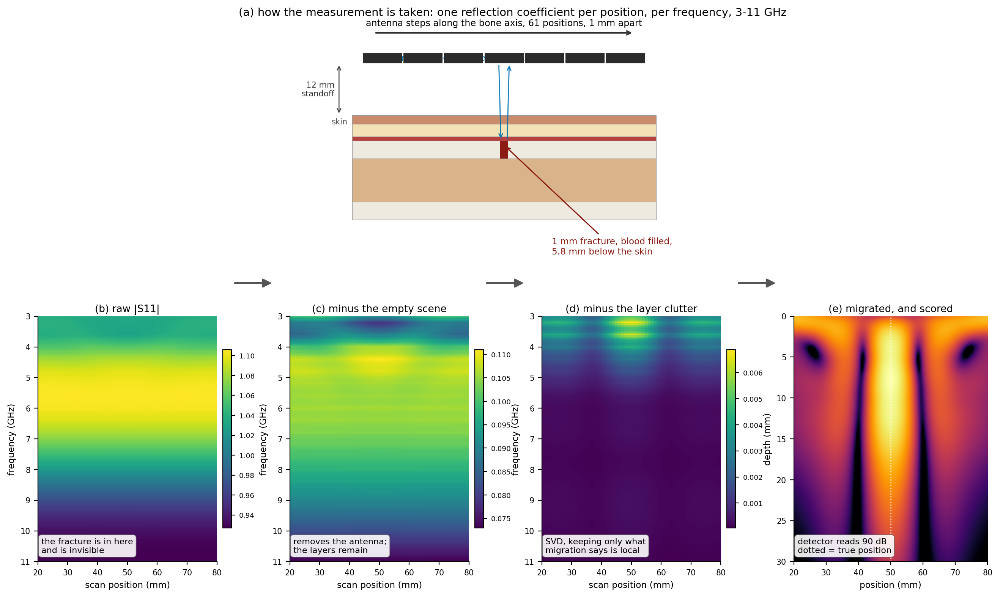
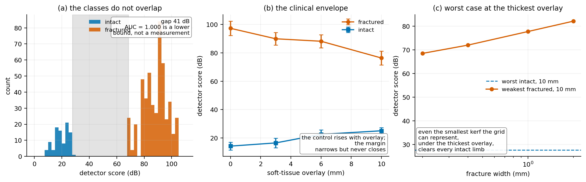

# bonesim — Virtual UWB Microwave Imaging for Long-Bone Fracture Detection

[](LICENSE)
[](environment.yml)
[](tests/)

A fully in-silico study of monostatic ultra-wideband microwave imaging at 3–11 GHz for
detecting fractures in long bones, with SVD clutter removal and Kirchhoff migration.

**No hardware was built.** Every number below is produced by the code in this repository.

📄 **[Full report (20 pages, 12 figures)](Bone_Fracture_RF_Sensing_Report.pdf)**

---

## Headline results

| | |
|---|---|
| **Class separation** | **40.8 dB**, no overlap, across 192 full-wave acquisitions |
| Area under ROC curve | 1.0000 (bootstrap CI 1.000–1.000, permutation *p* = 0.001) |
| Leave-one-specimen-out | sensitivity 0.998, specificity 1.000 |
| Repeatability | ICC(1,1) = 0.998 |
| Antenna match | 2.48–12.00 GHz, 99.69% of the design band |
| RF exposure | all ICNIRP/IEEE limits pass, minimum margin 18× |

Design space covered: 8 simulated specimens × 4 soft-tissue overlays (0–10 mm) ×
6 fracture states (0.2–2.0 mm kerf, plus oblique and intact).

### How a measurement is taken and processed



Every panel except the schematic is real solver output from one matrix cell — a 1 mm
fracture under 6 mm of overlay. The fracture is genuinely invisible in the raw data,
still buried after empty-scene subtraction, and only emerges after clutter removal.

---

## The finding worth reading, which is not the AUC

An AUC of 1.0000 is normally a sign of a data leak, and it was treated as one. It
survives inspection — the two classes are separated by a real 40.8 dB gap with no
overlap, and the weakest fractured cases are exactly the physically hardest ones. But a
perfect score is **saturated**, and a saturated statistic cannot measure margin.

That is demonstrated rather than asserted. Re-scoring the whole matrix over a restricted
band, with no new simulation:

| band | bandwidth | AUC | separation |
|---|---|---|---|
| 3.00–11.0 GHz (design target) | 8.00 GHz | 1.0000 | **40.8 dB** |
| 4.35–11.0 GHz (initial antenna) | 6.65 GHz | 1.0000 | **17.9 dB** |
| 5.00–11.0 GHz (deliberately worse) | 6.00 GHz | 1.0000 | 16.0 dB |

**Removing 3.00–4.35 GHz costs more than half the separation. The AUC registers none of
it.** Reporting that statistic alone would have supported the incorrect conclusion that
the antenna's shortfall was inconsequential — and it is what motivated the antenna
redesign that recovered the band. See [`docs/band-study.md`](docs/band-study.md).



---

## What this is, and what it is not

This is a **simulation study**. It answers *"if you built this instrument, what would it
be able to detect?"* — it is not a measurement of a real bone.

That distinction matters because simulated imaging studies have a specific, well-known
failure mode, and this repository is organised around avoiding it.

### The inverse-crime problem

If the model that **generates** the data and the model that **reconstructs** the image
share their assumptions, reconstruction always succeeds and the result is circular. This
is an *inverse crime*, and it is the first thing a competent reviewer looks for.

The countermeasures are structural, not cosmetic:

| | Forward model (data) | Inverse model (image) |
|---|---|---|
| Physics | Full-wave FDTD, dispersive tissue | Migration in a homogeneous medium |
| Tissue | 4-Cole-Cole → multi-pole Debye, 6 layers | One scalar `eps_avg`, found by autofocus |
| Geometry | Layered cortex, marrow cavity, real kerf | Unknown; never supplied to the reconstructor |
| Grid | FDTD cells, 0.2 mm | Independent imaging grid |
| Instrument | Noise, cable drift, stage jitter injected | Blind to all injected error |

The reconstructor is never given the permittivity profile, the bone geometry, the
fracture position, or the noise realisation. It sees a matrix of complex S11 values,
exactly as it would from a VNA.

### What simulation cannot supply

Hardware gives you certain error sources for free. In simulation they must be modelled
explicitly, and the study's credibility rests on how honestly that is done:

- VNA receiver noise at finite IF bandwidth
- Cable phase drift between scan positions
- Linear-stage position jitter and backlash
- Standoff (antenna-to-skin) variation
- Specimen-to-specimen variation in tissue properties and bone geometry

These live in `bonesim/perturb/` and are applied **after** the forward solve, so one FDTD
result generates several independent "remounts" — cheaper, and physically correct, since
a remount changes the instrument rather than the anatomy.

---

## Honest limitations

Stated here rather than buried, because a result whose limits are not stated cannot be
assessed. Full discussion in [the report](Bone_Fracture_RF_Sensing_Report.pdf), §8.

1. **The injected error model is the binding assumption.** A real bench adds cable flex,
   connector repeatability, operator variation and genuine inter-bone heterogeneity. The
   40.8 dB margin is the budget those unmodelled terms must consume.
2. **Every fracture is at a known position.** This measures separability, not
   localisation.
3. **Propagation is 2D TMz.** A 3D cylindrical model has been built and verified
   (`bonesim/geometry/cylindrical.py`) but the comparison has not yet been run.
4. **Eight simulated specimens are not eight cadaveric bones.**
5. **The imaging model excites with an elementary dipole**, not the Vivaldi of Stage 5.
6. **Antenna gain is unmet at 3 GHz** — 7.02 dBi against an 8–10 dBi requirement, shown
   not to be reachable by resizing within the specified board.
7. **Exposure is assessed by simulation**, not by IEC 62209 measurement.

---

## Repository layout

```
bonesim/
  materials/   Gabriel 4-Cole-Cole tissue models -> multi-pole Debye fits for FDTD
  geometry/    Layered phantom, and the 3D cylindrical limb
  forward/     Data generation. Interchangeable backends:
                 analytic.py   fast layered Green's function (seconds, for development)
                 gprmax.py     full-wave 2D FDTD B-scan (hours, for the real dataset)
                 gprmax3d.py   full-wave 3D, cylindrical limb
  antenna/     Antipodal Vivaldi geometry and the openEMS model
  vna/         Instrument emulation: time domain -> S11(f), IF bandwidth, noise floor
  perturb/     Injected instrument and specimen error models
  process/     Empty-scene subtraction, SVD clutter removal, time gating, migration
  detect/      Scalar detection metric (peak-to-background ratio)
  stats/       ROC/AUC, leave-one-specimen-out CV, permutation test, bootstrap CIs
  safety/      SAR and absorbed power density against ICNIRP 2020 / IEEE C95.1
scripts/       Entry points; every figure and number in the report comes from one
config/        Experiment matrix definitions and solver settings
tests/         146 unit tests, including the analytic-vs-FDTD cross-check
docs/          Install notes, per-stage findings, and the statistical analysis plan
notebooks/     Colab notebooks for the GPU runs
figures/       Committed, because they cannot be rebuilt without the 127 MB of runs/
```

The forward backends share one interface. The processing chain cannot tell them apart,
which is what makes it possible to develop and unit-test the whole pipeline in seconds
and only then spend FDTD hours on it.

---

## Status

| Stage | Description | State |
|---|---|---|
| 0 | WSL2 environment, gprMax, compute benchmark | **complete** |
| 1 | Cole-Cole → Debye fitting, validated against published curves | **complete** |
| 2 | Analytic forward model + full processing chain | **complete** |
| 3 | gprMax geometry builder and B-scan driver | **complete** |
| 4 | Brass-rod validation gate | **complete** |
| 5 | Antipodal Vivaldi in openEMS | **complete** — 2.48–12.00 GHz; gain unmet at 3 GHz, see [`docs/stage5-findings.md`](docs/stage5-findings.md) |
| 6 | Full 192-cell experiment matrix (8 specimens) | **complete** — 192/192 on a Colab T4 |
| 7 | Statistical analysis plan | **complete** — see [`docs/stage7-findings.md`](docs/stage7-findings.md) |
| 8 | 3D cylindrical limb | **model built and verified; run pending** |
| — | RF exposure assessment | **complete** — 0 dBm adopted, all limits pass by ≥18×, see [`docs/safety-sar.md`](docs/safety-sar.md) |
| — | Bill of materials for a physical build | **documented** — every spec traced to the simulation; cheap-VNA fallbacks scored on the solved matrix (LiteVNA-64 band 51.5 dB, 36.4 dB at 70 dB dynamic range), see [`docs/bill-of-materials.md`](docs/bill-of-materials.md) |

Stage 4 was the go/no-go gate: if migration could not image a 6 mm conducting rod at
20 mm depth in phantom, nothing downstream would be meaningful.

---

## Reproducing

Reading the results needs nothing but Python. Regenerating the *data* needs gprMax and
openEMS, both built from source — see [`docs/install.md`](docs/install.md).

```bash
conda env create -f environment.yml && conda activate bonesim   # or: pip install -r requirements.txt
python -m pytest tests/ -q          # 146 tests, no solver required
python scripts/run_sar.py           # exposure assessment, no solver required
python scripts/make_report.py       # rebuild the PDF from committed figures
```

With solver output present in `runs/` (127 MB, not hosted here):

```bash
python scripts/make_figures.py      # every figure in the report
python scripts/run_stage7.py        # the statistical analysis
python scripts/run_band_study.py    # the bandwidth study
```

Source lives on the Windows filesystem; simulation output is written to WSL-native
storage, because gprMax produces many small HDF5 files and cross-filesystem I/O under
WSL2 is roughly an order of magnitude slower.

### A note on measured timings

Every runtime figure in this repository is measured, not extrapolated. That rule exists
because an early convergence estimate of "about 40 hours" turned out to be the laptop
entering Modern Standby and suspending the solver while gprMax kept counting wall-clock
time; the real figure was 10 minutes. openEMS's Mcell/s reading is the honest one,
because it excludes suspended time.

---

## Third-party software

| Tool | Role | Licence |
|---|---|---|
| [gprMax](https://github.com/gprMax/gprMax) 3.1.7 | 2D/3D FDTD forward solver | GPLv3 |
| [openEMS](https://github.com/thliebig/openEMS-Project) v0.37.0-rc1 | Antenna FDTD, S-parameters, far fields | GPLv3 |

Neither is vendored here; both are built from source per `docs/install.md`. Tissue
dielectric parameters are the Gabriel four-Cole-Cole models; densities are from the
IT'IS Foundation database v4.1.

## Licence and citation

MIT — see [LICENSE](LICENSE). If you use this work, please cite it; metadata is in
[CITATION.cff](CITATION.cff).
